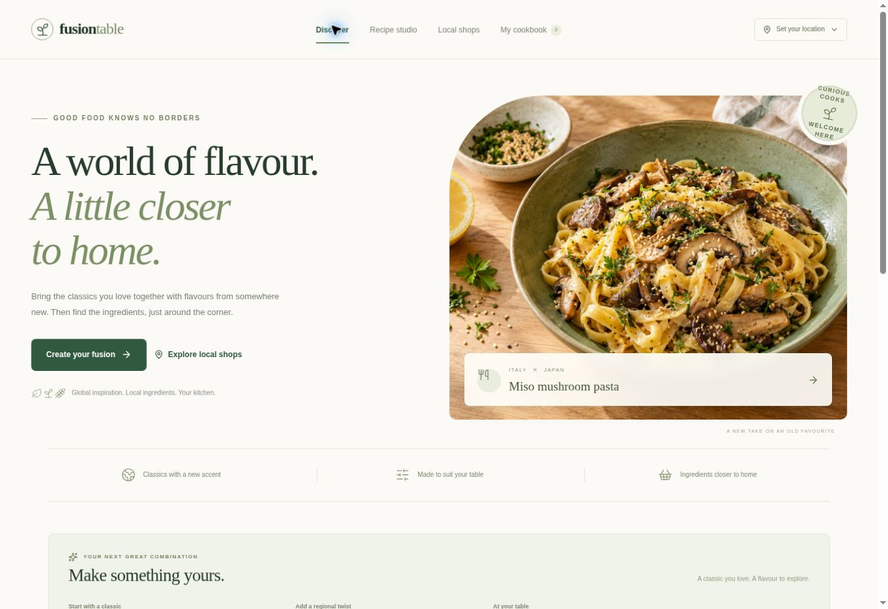

# Fusion Table

**Familiar classics, proper barbecue methods, regional flavour and nearby places to shop.**

Fusion Table is a responsive cooking website built from deterministic, authored recipe templates. Choose a classic and region, or start with a main ingredient and cooking method. The app assembles measured ingredients, appropriate substitutions, cooking steps, shopping suggestions and a browser-local cookbook. Identical inputs produce identical recipes. There is no runtime language model, model-generated recipe endpoint or random recipe generator.

All application source, recipe catalogs, images, server routes, tests, build tooling and lockfiles are included in this repository.



Earlier homepage preview; the current source also includes the expanded catalog and ingredient-led builder.

## What's in v0.2.0

- **28 classics × 24 regions = 672 classic/region pairings**, with all **5 dietary preferences** supported: **3,360 classic/region/diet configurations** before servings, heat and pantry choices.
- The original **8 classics, 8 regions and 5 diets remain available**, with 20 new barbecue/smoking classics and 16 new regional profiles added.
- A separate ingredient-led builder with **22 mains**, **12 techniques**, **20 regions** and **6 sides**: **23,400 compatible main/method/region/side configurations** from 195 supported main/method pairs.
- Servings from **1–12**, adjustable heat, exact pantry matching, measured ingredients, estimated times, allergens, equipment and technique notes.
- Distinct methods for poultry, whole cuts, seafood, sausages, ready-to-eat smoked products and plant alternatives, including outdoor and kitchen options where appropriate.
- A nearby shop finder, cooking mode, saved recipes, notes, ratings, JSON cookbook exports and CSV shopping exports.
- Clone/build documentation, environment examples, unified tests, CI, an independent Cloudflare deployment helper and source/Worker release assets.

These numbers describe supported template configurations, **not independently kitchen-tested recipes**. Every generated result is labelled exactly **“Template-generated · not kitchen-tested”**. Cooking times are estimates; follow the method's doneness checks and check packaged-food labels for your dietary needs.

## New barbecue and smoking classics

| New classic | What the template does |
| --- | --- |
| **Smoked brisket-style plate** (`smoked-brisket`) | Slow-cooked brisket or a mushroom-and-tempeh plate with buns and slaw; small meat portions use a covered oven method. |
| **Hot-smoked fish** (`hot-smoked-fish`) | Hot-smoked salmon or tofu with potatoes and green beans; fillet alternatives and an ordinary oven option are explained. |
| **Cold-smoked service platter** (`cold-smoked-platter`) | Assembles commercially ready-to-eat cold-smoked salmon, pasteurised hard smoked cheddar or fully cooked ready-to-eat smoked tofu. |
| **BBQ pulled protein** (`bbq-pulled-protein`) | Pull-apart pork shoulder or jackfruit and cannellini beans in slaw buns; chicken-thigh and lamb-shoulder alternatives have their own guidance. |
| **Grilled skewers & kebabs** (`grilled-skewers`) | Even chicken-thigh or tofu pieces with vegetables, rice, salad and separately cooked sauce; other cuts have specific timings. |
| **Smoked or grilled sausages** (`bbq-sausages`) | Raw pork links or labelled plant sausages with warm flatbread and salad; fresh and already-cooked sausage products receive different methods. |
| **Reverse-seared steak or chop** (`reverse-seared-steak`) | Thick sirloin gently heated then seared, with a thick pork-chop option; cauliflower slabs use a separate roast-then-sear method. |
| **Smoked vegetable & protein tray** (`smoked-vegetable-tray`) | Aubergine, cauliflower and peppers with halloumi or tofu, using outdoor smoke or ordinary oven cooking. |
| **BBQ ribs & short ribs** (`bbq-ribs`) | Tender pork ribs with beef-short-rib guidance, or tempeh-and-mushroom strips; sweet sauce is added after cooking. |
| **Smoked dip & cheese fondue** (`smoked-cheese-dip`) | Hot cheddar-provolone fondue or a white-bean dip, with a short outdoor smoke or gentle oven method and bread/vegetable dippers. |
| **Grill-roasted whole fish** (`grill-roasted-whole-fish`) | Cleaned whole trout with a mackerel alternative, or a steamed-then-roasted cauliflower centrepiece. |
| **Smoked grain & bean bowl** (`smoked-grain-bowl`) | Fully cooked rice and beans receive a short hot-smoke, with grilled tempeh, peppers and fresh salad. |
| **BBQ wings & crisp florets** (`bbq-wings`) | Wings cook indirectly before a quick crisping stage; cauliflower and chickpeas use their own roasting method. |
| **Smoked belly-style bites** (`smoked-pork-belly`) | Pork belly cooks tender before a brief browning, while tofu and aubergine use a shorter plant method. |
| **Grill-roasted whole bird** (`grill-roasted-whole-chicken`) | An unstuffed bird for four or more servings, bone-in portions for one to three, or a mushroom-and-tofu roast. |
| **Smoked turkey breast** (`smoked-turkey-breast`) | Boneless turkey breast or tempeh slabs with potatoes and green beans; smaller breast portions have shorter starting checks. |
| **Charred prawns** (`grilled-prawns`) | Raw prawns or tofu cooked separately from courgette to suit each ingredient, with rice and salad. |
| **Charred octopus-style plate** (`charred-octopus`) | Commercially fully cooked octopus reheated then briefly charred, or king oyster mushrooms and beans, with warm potatoes. |
| **Flank, skirt & sirloin grill** (`grilled-flank-steak`) | Thin whole-muscle steaks grilled, rested and sliced across the grain; a portobello-and-bean plate supplies the plant version. |
| **BBQ lamb chops & leg steaks** (`bbq-lamb-chops`) | Measured-thickness lamb chops with leg-steak/pork-chop alternatives, or tofu steaks with potatoes and greens. |

The original classics are creamy pasta, street-style tacos, mushroom risotto, classic burgers, Sunday traybake, fried rice, loaded flatbread and cottage pie.

### Cold-smoked products and kitchen alternatives

The cold-smoked platter uses **commercially ready-to-eat smoked products** or fully cooked alternatives. It does not provide a home raw-fish curing recipe or imply that cold smoke cooks raw fish. Follow the product's refrigeration/use-by instructions and the recipe's cold-chain guidance. The recipe includes guidance for people who should avoid chilled smoked seafood, with fully cooked alternatives.

Outdoor smoking, direct grilling, indirect cooking and oven smoke-style seasoning are described separately in the method notes. An ordinary oven plus smoked seasoning is a kitchen alternative; it is not described as producing the same smoke process. Smoking wood or fuel is not a mandatory food ingredient in the shopping list. Sweet regional sauces are prepared and applied as directed so they do not simply burn over high heat.

## New regional profiles

| New profile | Flavour direction |
| --- | --- |
| **Texas BBQ** (`texas-bbq`) | Black pepper, smoked paprika and a bright tomato finish. |
| **Carolina BBQ** (`carolina-bbq`) | Vinegar, pepper, a little maple and fresh spring onion. |
| **Kansas City BBQ** (`kansas-city-bbq`) | Smoked paprika with tomato, molasses and cider vinegar. |
| **Argentine asado** (`argentine-asado`) | Oregano, parsley and a chimichurri-inspired vinegar finish. |
| **Korean BBQ** (`korean-bbq`) | Ginger, pear, soy and toasted sesame, with adjustable chilli. |
| **Japanese yakitori** (`japanese-yakitori`) | A light soy-maple finish with ginger and spring onion. |
| **Cantonese char siu** (`cantonese-char-siu`) | Five-spice and ginger with a light tomato-soy finish. |
| **Vietnamese grill** (`vietnamese-grill`) | Lemongrass, ginger, lime and fresh coriander. |
| **Turkish mangal** (`turkish-mangal`) | Cumin, paprika and mint, lifted with lemon and sumac. |
| **Greek souvlaki** (`greek-souvlaki`) | Oregano, thyme, lemon and fresh dill. |
| **Spanish plancha** (`spanish-plancha`) | Smoked paprika with roasted peppers, almonds and parsley. |
| **Jamaican jerk** (`jamaican-jerk`) | Allspice, thyme, ginger and lime, with chilli to your taste. |
| **Indian tandoor** (`indian-tandoor`) | Ginger, cumin, coriander and paprika with lemon and mint. |
| **Mexican al pastor** (`mexican-al-pastor`) | Smoky cumin and oregano with pineapple, lime and coriander. |
| **Moroccan mechoui** (`moroccan-mechoui`) | Cumin, coriander, ginger and paprika with lemon and parsley. |
| **South African braai** (`south-african-braai`) | Coriander and paprika with a light apricot-mustard finish. |

The original Japanese, Korean, Thai, Mexican, Indian, Levantine, Italian and Moroccan profiles remain. These are practical fusion adaptations with authored ingredient quantities; a region name is not a claim of traditional authenticity.

## Make a meal

1. In the classic studio, choose a familiar or barbecue classic and a regional profile. Alternatively, choose a main ingredient, supported method, region and side in the ingredient-led builder.
2. Set servings, dietary preference, heat and any ingredients already in your pantry.
3. Create the recipe and review the quantities, equipment, method notes and doneness guidance.
4. Use cooking mode, save the recipe, or find shops for missing ingredients.
5. After cooking, record your rating, changes and your own cooked status. Export recipes/cookbooks as JSON or the shopping list as CSV.

Classic templates supply deliberate dietary adaptations. The ingredient-led builder preserves the main you selected: a vegan setting does not silently replace chicken, so choose a compatible plant main there.

Local discovery searches a **1–25 km straight-line radius** around a selected suburb, town, postcode or browser-provided location. It includes mapped supermarkets, greengrocers, butchers, fishmongers, markets and other food shops.

**Shop listings use live map data; stock and prices are unverified.** The app suggests plausible shop types and useful retailer links. Check availability, market operating days and dietary variants with the shop before travelling. Map coverage is limited and travel distances can be longer.

## Clone and run

The GitHub repository is currently **private**. You need access granted by its owner to clone it or download releases. An authorised source-release ZIP can also be extracted and built without Git.

Requirements: **Node.js 22.13.0+** and **pnpm 11.25.0**. Install the pinned package manager if necessary:

```sh
npm install --global pnpm@11.25.0
```

Then:

```sh
git clone https://github.com/blkph0x/fusion-table.git
cd fusion-table
pnpm install --frozen-lockfile
pnpm dev
```

Open the local URL printed by the server, normally `http://localhost:5173`. A clean checkout automatically uses the portable profile. Recipe composition needs no credentials, database or network call. Live map searches need internet access.

| Command | Purpose |
| --- | --- |
| `pnpm dev` | Start the complete local application. |
| `pnpm test` | Discover and run every test under `tests/`, including the full barbecue matrix. |
| `pnpm typecheck` | Check application and test TypeScript. |
| `pnpm lint` | Run ESLint. |
| `pnpm build` | Build the Worker and client assets into `dist/`. |
| `pnpm start` | Preview the built Worker locally; this does not publish. |
| `pnpm deploy:cloudflare --name your-fusion-table --dry-run` | Validate an independent deployment without uploading. |
| `pnpm deploy:cloudflare --name your-fusion-table` | Publish the built app to your own Cloudflare account after login. |
| `pnpm release:source` | Archive clean, committed source and write a SHA-256 checksum. |
| `pnpm release:worker` | Package a fresh build into an independent Worker archive; requires `tar`. |

The supplied `install:ci` command is for the managed Linux Sites environment and uses Bash, `flock` and GNU `timeout`. Ordinary clones and GitHub CI use `pnpm install --frozen-lockfile`.

For maintainers, changing the version in `package.json` and pushing to `main` triggers the versioned release workflow. It runs all checks and creates a missing `vVERSION` release with source ZIP, Worker archive and checksums. Existing releases/assets are preserved. Include matching `docs/releases/vVERSION.md` notes; manual dispatch is also supported.

See **[Self-hosting and building your own app](docs/SELF_HOSTING.md)** for independent deployment, map configuration, release packaging and reuse of both deterministic engines. The complete website has server routes; uploading only static assets to GitHub Pages does not provide live location/shop search.

## Map data, privacy and storage

[Photon](https://github.com/komoot/photon) and [OpenStreetMap](https://www.openstreetmap.org/copyright) provide default location/shop data without a key. An optional Overpass adapter is included. Configure provider URLs/selection on the server using `.dev.vars.example` or `.env.example`. Read [Live location and shop data](docs/LOCATION_DATA.md) for attribution, contracts, coverage and limits.

Saved recipes, ratings, notes, location and radius live in the current browser's `localStorage`. They do not sync across devices. Clearing site data removes them; exports retain a portable copy. Saved recipes keep their complete snapshot when the generator changes. New saves are limited to 100 recipes; existing entries are retained, and you can export the cookbook before making room.

Location queries send only the required location text or coordinates to the selected map provider. Cookbook history and notes are not part of those requests. Browser geolocation is requested only after the visitor chooses it. Recipe composition itself makes no external service request.

The existing Sites deployment remains private under its platform settings. `.openai/hosting.json` preserves that Site's identity. A separate Cloudflare deployment has its own audience and authentication settings and does not inherit Sites access controls.

## Project background and implementation

Fusion Table is an independent application inspired by the proposal/check/observation workflow in [blkph0x/p-vs-np-proof-research](https://github.com/blkph0x/p-vs-np-proof-research), inspected at commit [`7dedc73f758dfbdc072e7aa29dfc08505761ebd5`](https://github.com/blkph0x/p-vs-np-proof-research/tree/7dedc73f758dfbdc072e7aa29dfc08505761ebd5). It does not use SAT solvers as a cooking engine or rely on a P-versus-NP result.

Read [Architecture](docs/ARCHITECTURE.md) for implementation boundaries, validation, storage and image provenance. Automated checks cover structure and declared constraints; taste, repeatability and retailer stock need separate real-world evidence.
